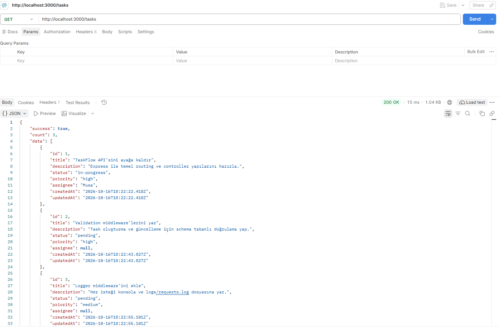
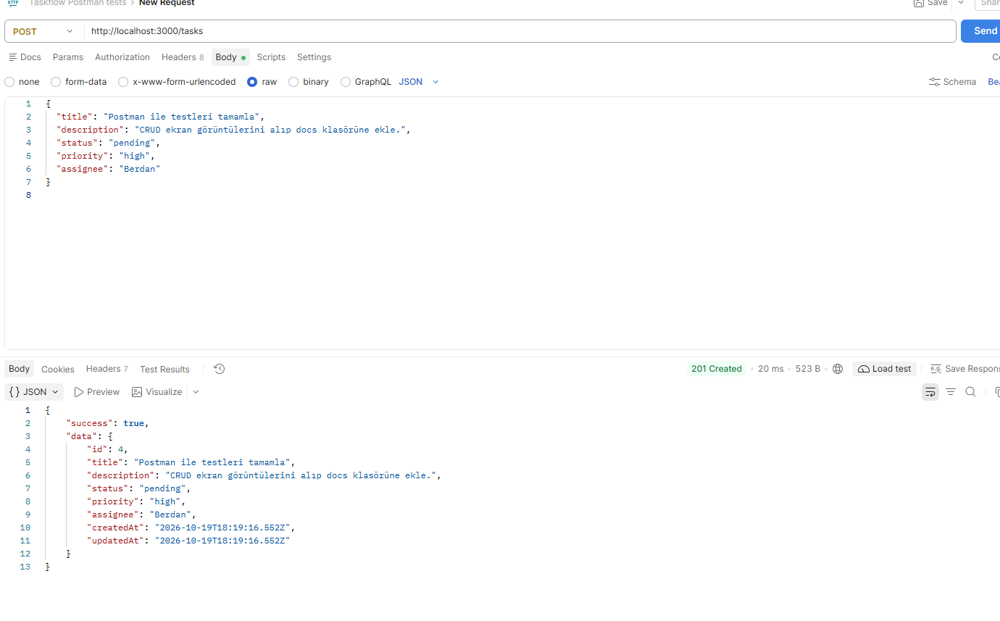
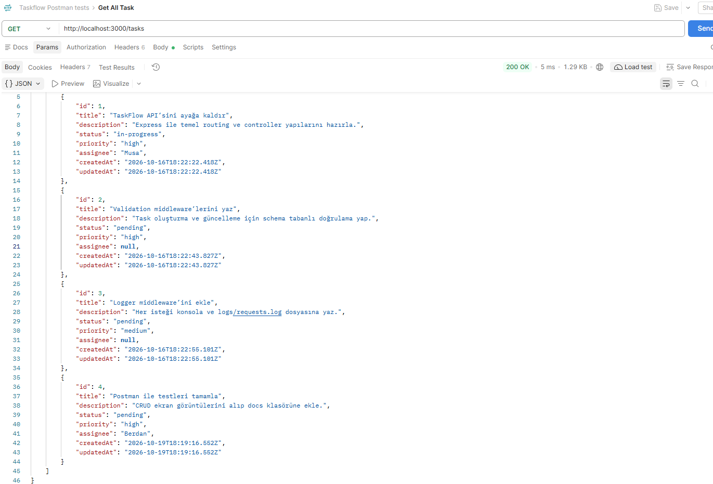
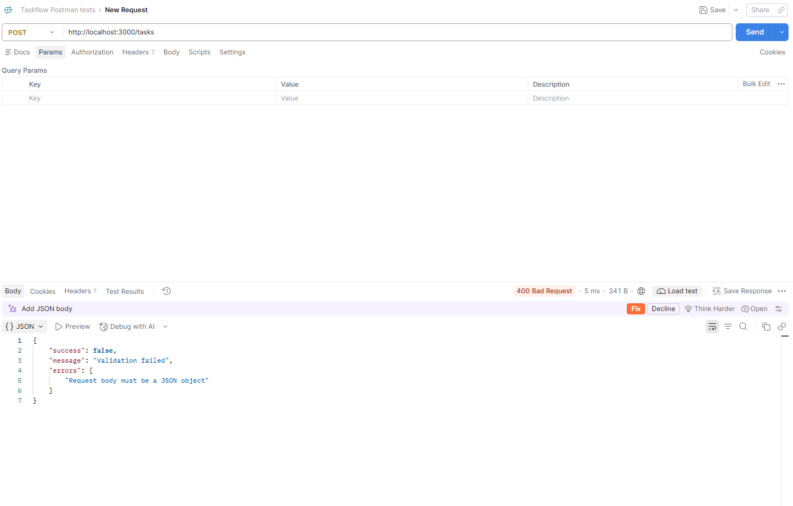
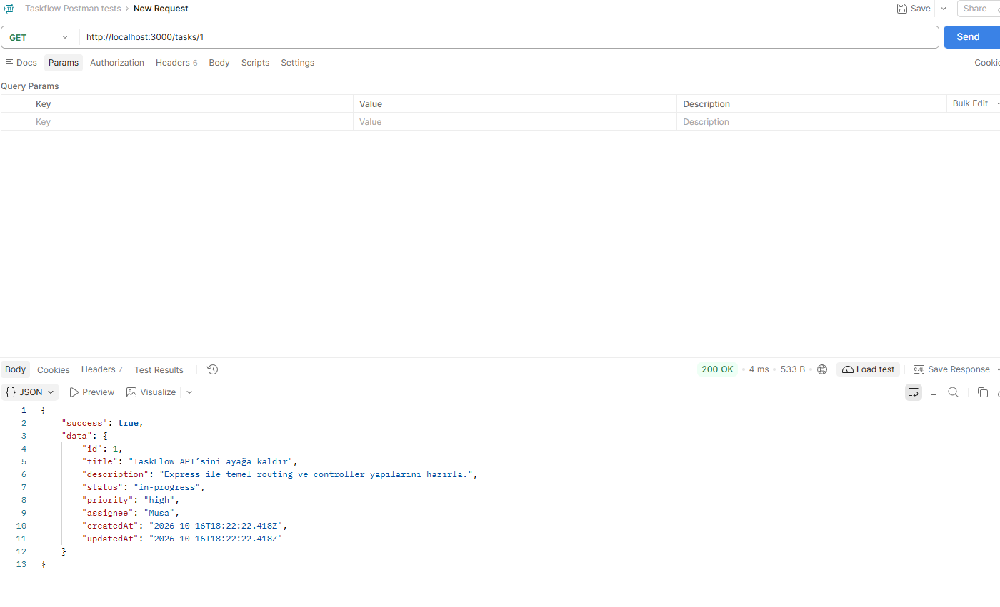
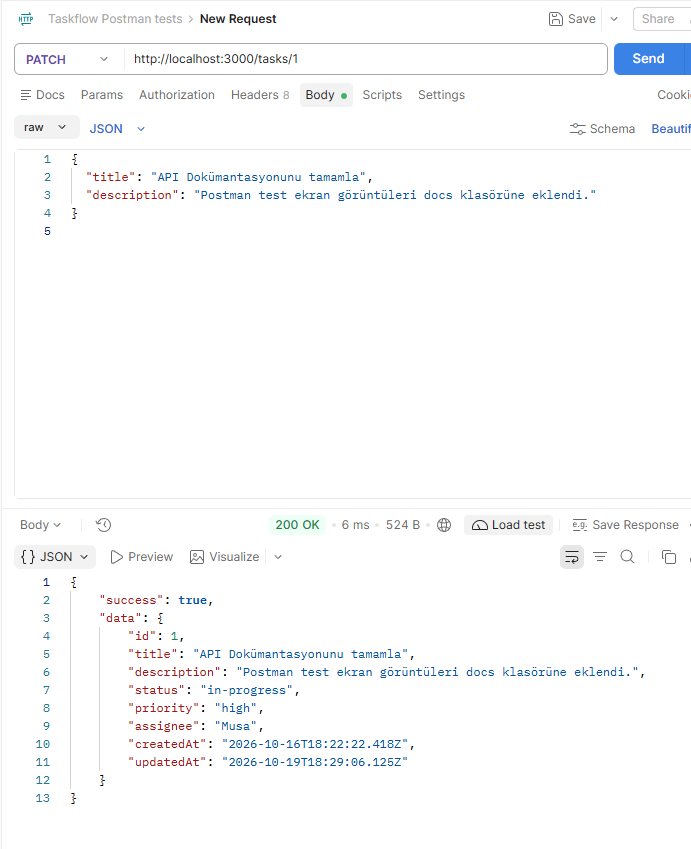
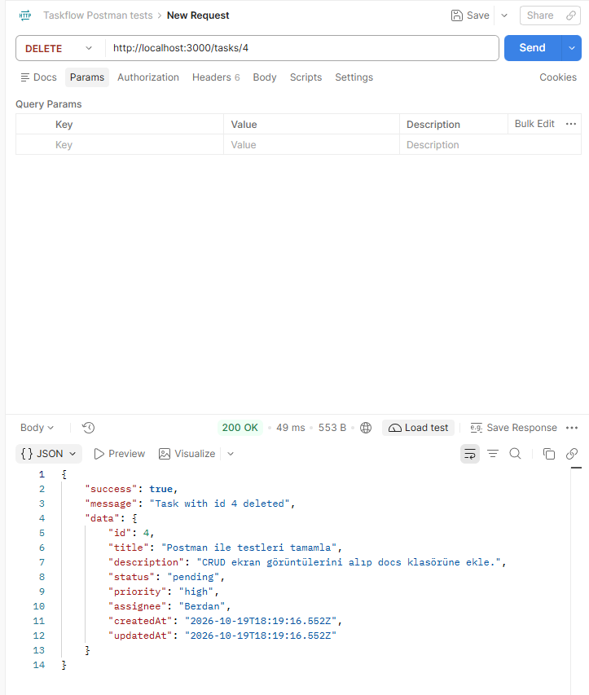
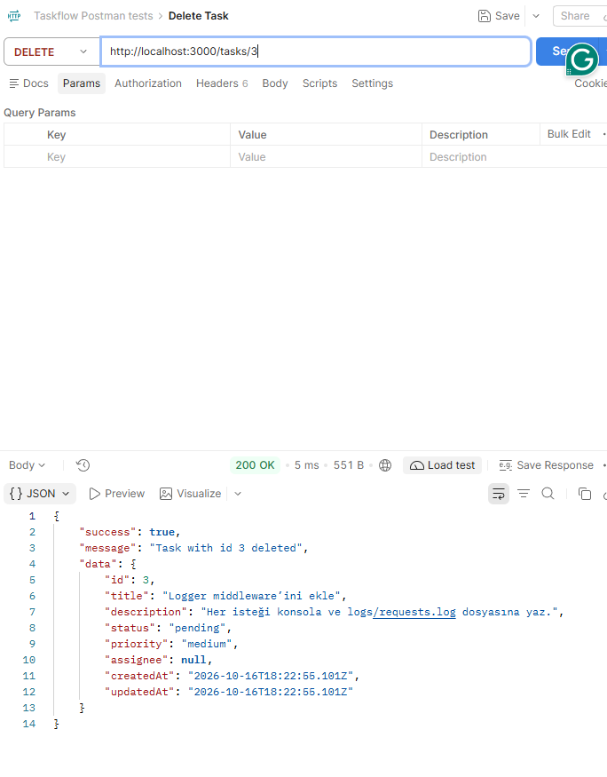
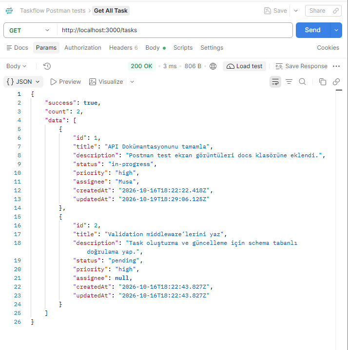

# TaskFlow API – Postman Test Ekran Görüntüleri

Bu doküman, TaskFlow REST API'sinin Postman üzerinde gerçekleştirilen CRUD ve doğrulama (validation) testlerinin kanıtlarını içerir.

---

## Test Senaryoları Özeti

| # | Senaryo | HTTP Method | Endpoint | Beklenen Durum | Dosya Adı |
|---|---|---|---|---|---|
| 1 | Tüm Görevleri Listeleme | `GET` | `/tasks` | `200 OK` | `1-get-all-tasks.png` |
| 2 | Yeni Görev Ekleme | `POST` | `/tasks` | `201 Created` | `2-Create-tasks.png` |
| 3 | Ekleme Sonrası Liste Kontrolü | `GET` | `/tasks` | `200 OK` | `3-after-create-task-get-all-user.png` |
| 4 | Eksik/Hatalı Body ile Ekleme (Doğrulama Testi) | `POST` | `/tasks` | `400 Bad Request` | `4-create-task-without-body.png` |
| 5 | ID ile Tekil Görev Detayı | `GET` | `/tasks/:id` | `200 OK` | `5-get-task-by-id.png` |
| 6 | Görev Güncelleme | `PATCH` | `/tasks/:id` | `200 OK` | `6-update-task.png` |
| 7 | Görev Silme (Adım 1) | `DELETE` | `/tasks/:id` | `200 OK` | `7-delete-task1.png` |
| 8 | Görev Silme (Adım 2 / Tekrar Silme) | `DELETE` | `/tasks/:id` | `200 OK / 404` | `7-delete-task2.png` |
| 9 | Silme Sonrası Liste Kontrolü | `GET` | `/tasks` | `200 OK` | `8-after-delete-task-get-all-user.png` |

---

## 1. Tüm Görevleri Listeleme (`GET /tasks`)
Mevcut görevlerin listelenmesi:

---

## 2. Yeni Görev Ekleme (`POST /tasks`)
Başarılı yeni görev oluşturma:

---

## 3. Görev Eklendikten Sonra Listeleme (`GET /tasks`)
Yeni eklenen görevin listede yer aldığının doğrulanması:

---

## 4. Eksik Body ile Görev Ekleme Hatası (`POST /tasks`)
`title` alanı gönderilmediğinde dönen 400 Bad Request doğrulama hatası:

---

## 5. ID ile Görev Detayı Getirme (`GET /tasks/:id`)
Belirli bir görevin detayının görüntülenmesi:

---

## 6. Görev Güncelleme (`PATCH /tasks/:id`)
Görevin alanlarının güncellenmesi:

---

## 7. Görev Silme (`DELETE /tasks/:id`)
Görevin başarıyla silinmesi:

Silme işleminin detay/tekrar kontrolü:

---

## 8. Silme Sonrası Liste Kontrolü (`GET /tasks`)
Silinen görevin listeden kaldırıldığının doğrulanması:

