# TaskFlow API – Postman Test Ekran Görüntüleri

Bu sayfa, Postman testlerinden alınan ekran görüntülerini gösterir. İstek gövdeleri, hazırlık ve beklenen sonuçlarla testleri yeniden uygulamak için [Postman senaryo rehberini](./postman-senaryolari.md) kullanın.

Görüntülerdeki ID, ad ve departmanlar rehberdeki örneklerden farklı olabilir. Bazı adımlarda önceden mevcut kullanıcı ve görevler kullanılmıştır; bu nedenle her görüntünün aynı kayıt üzerinde art arda yapılan bir işlemi gösterdiği varsayılmamalıdır.

## 1. Servis kontrolü

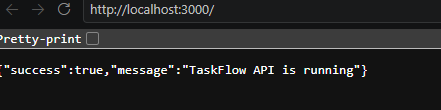

## 2. Kullanıcıları listeleme

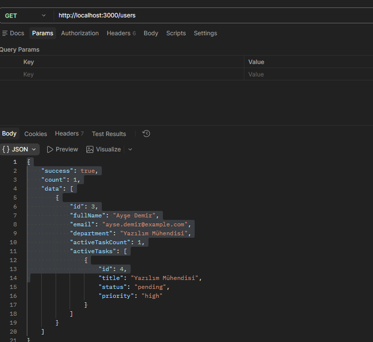

## 3. Kullanıcı oluşturma

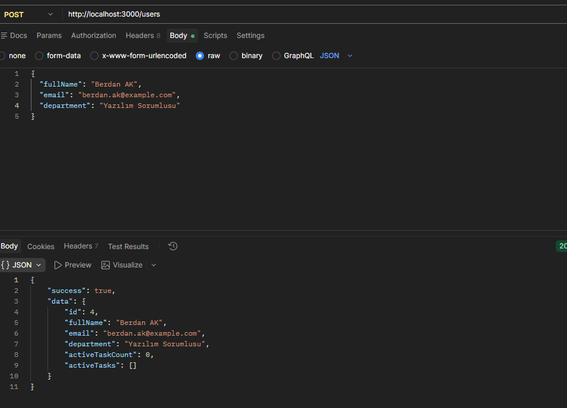

## 4. Kullanıcı detayı

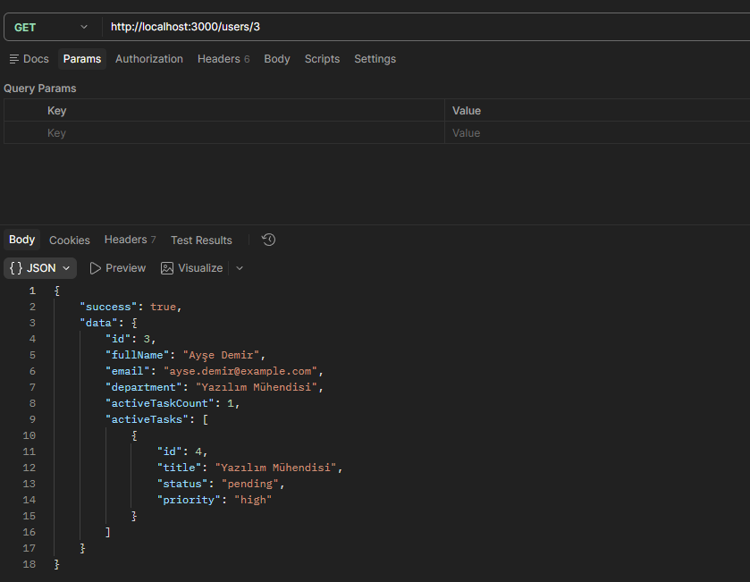

## 5. Bulunamayan kullanıcı

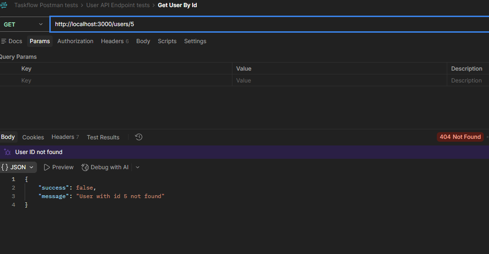

## 6. Zorunlu alan doğrulaması

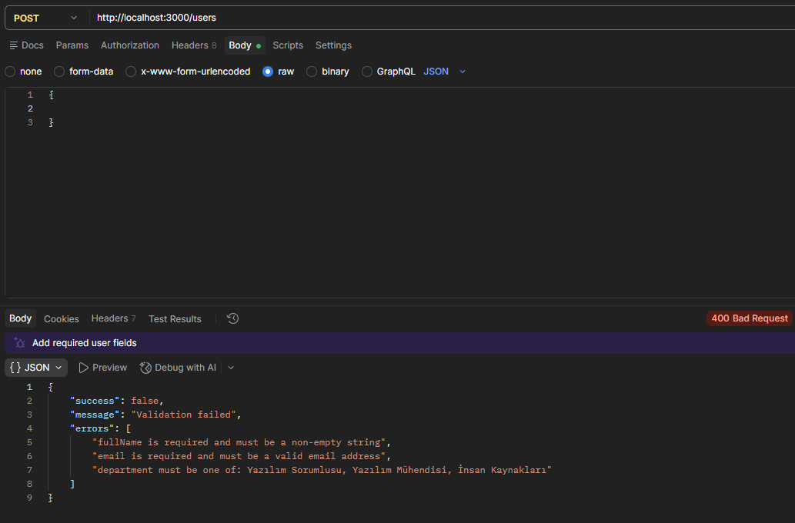

## 7. Geçersiz kullanıcı alanları

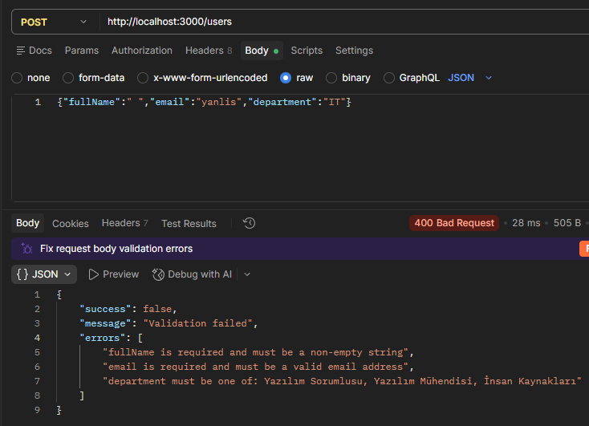

## 8. Tekrarlanan e-posta

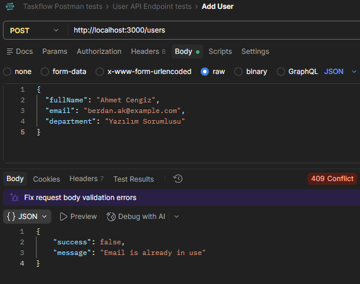

## 9. Kullanıcı güncelleme

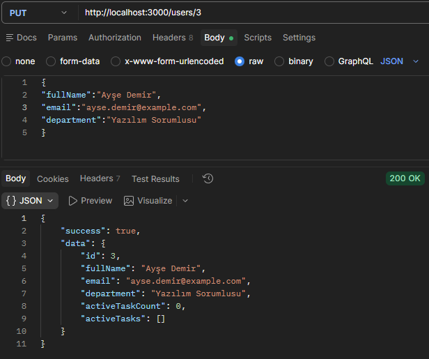

## 10. Kullanıcıyı kısmi güncelleme

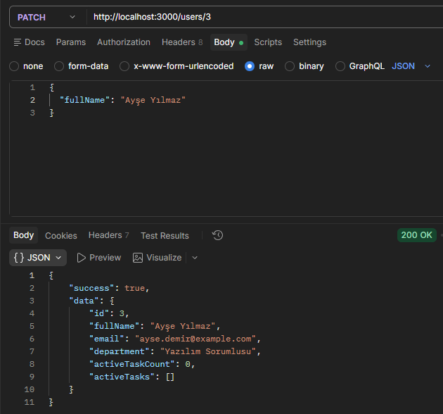

## 11. Görevleri listeleme

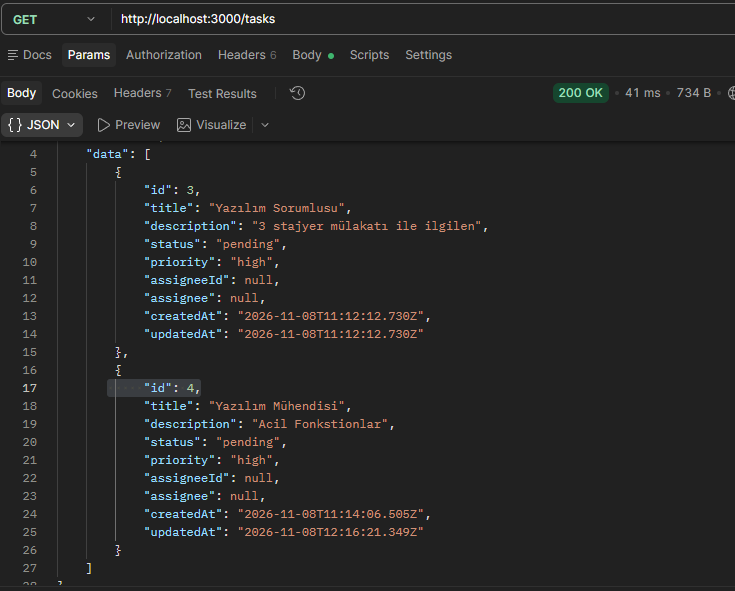

## 12. Görev oluşturma

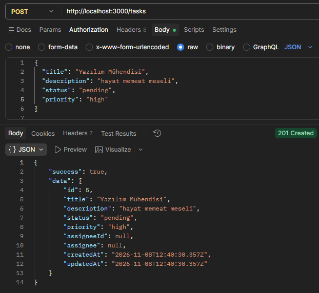

## 13. Geçersiz görev alanları

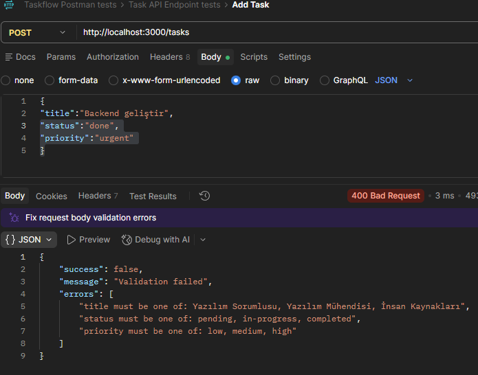

## 14. Görev detayı

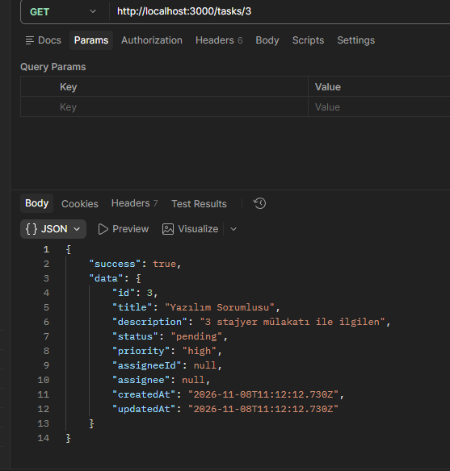

## 15. Uyuşmayan meslek grubuna atama

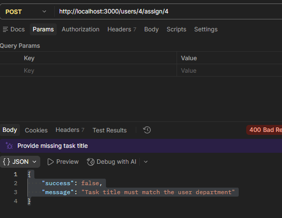

## 16. Görev atama

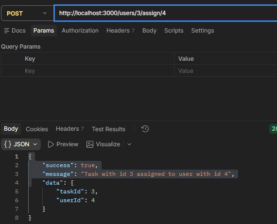

## 17. Kullanıcının aktif görevleri

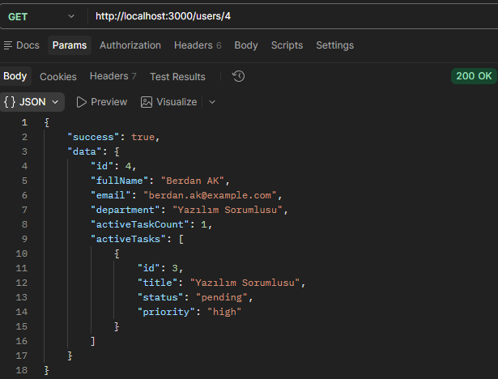

## 18. Görev güncelleme

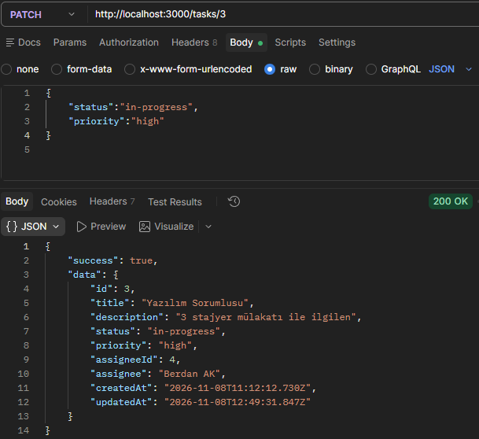

## 19. Görevi tamamlama

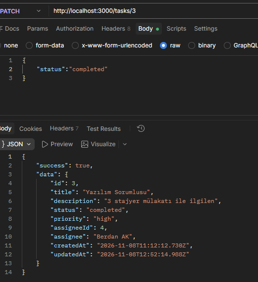

## 20. Tamamlanmış görevin aktif listeden çıkarılması

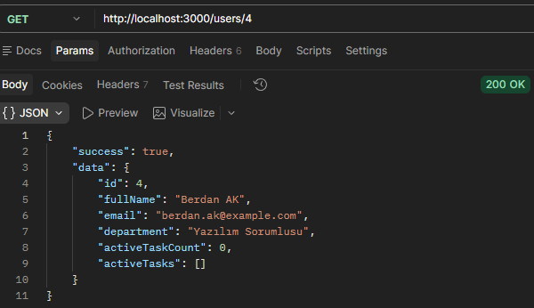

## 21. Görevleri filtreleme

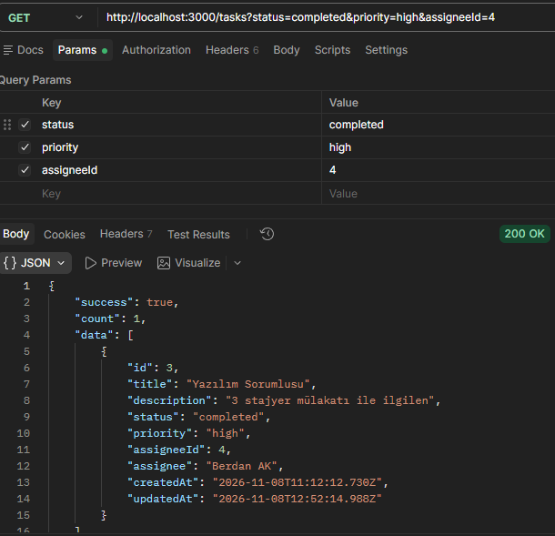

## 22. Geçersiz durum filtresi

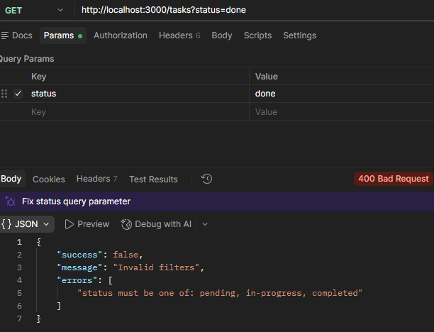

## 23. Görev silme

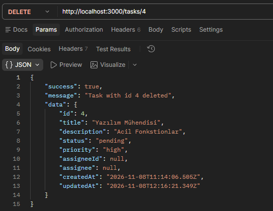

## 24. Silinmiş görevi sorgulama

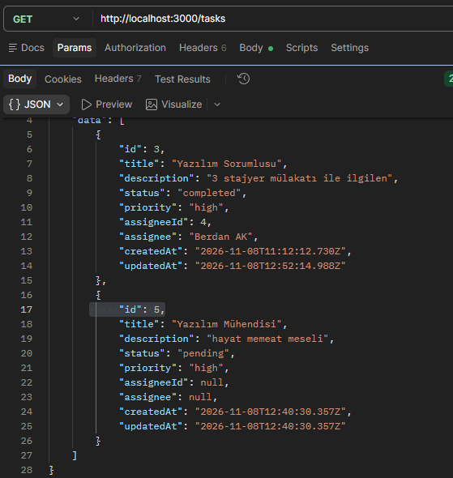

## 25. Silme testi için kullanıcı oluşturma

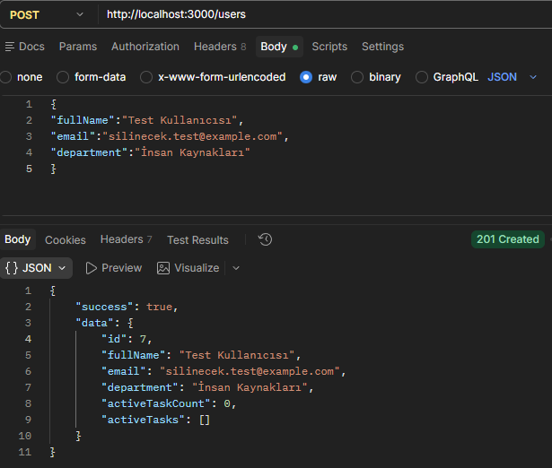

## 26. Kullanıcı silme

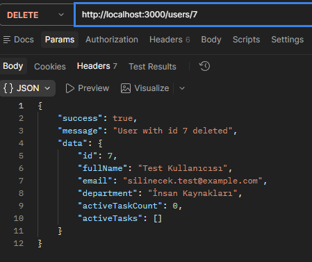
